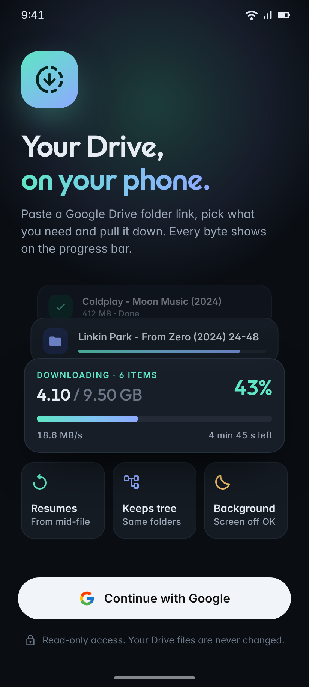
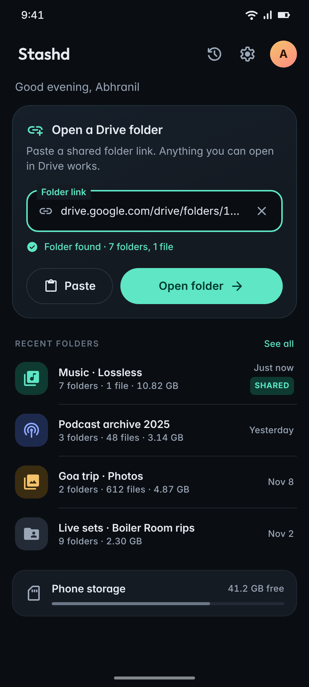
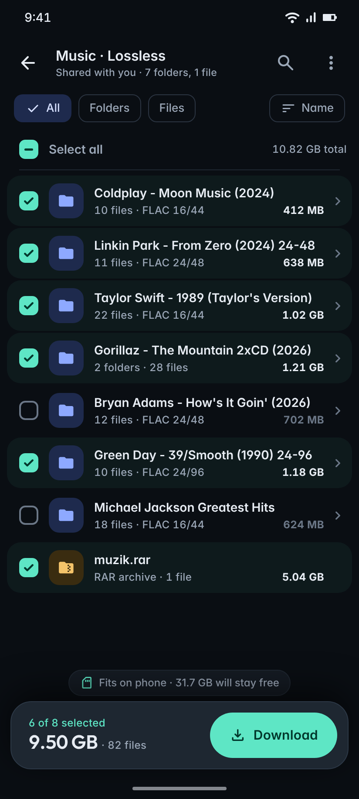
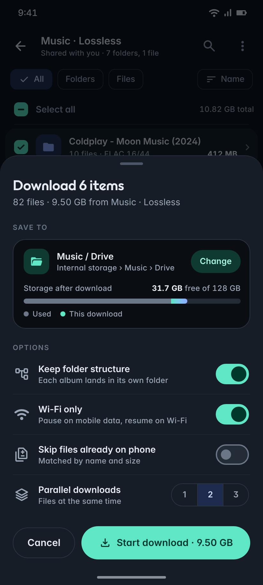
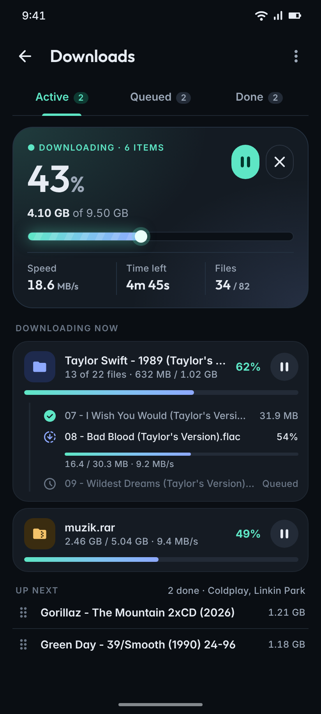
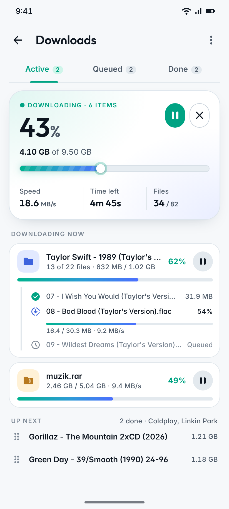
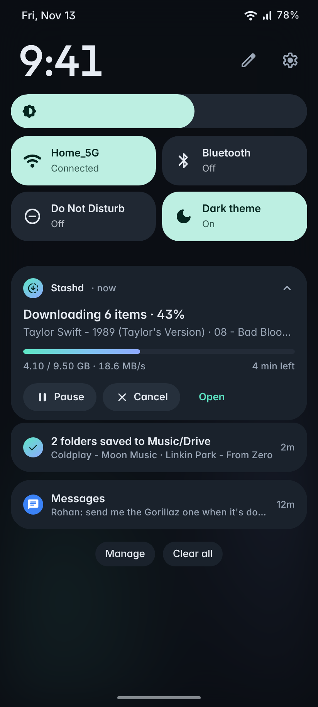
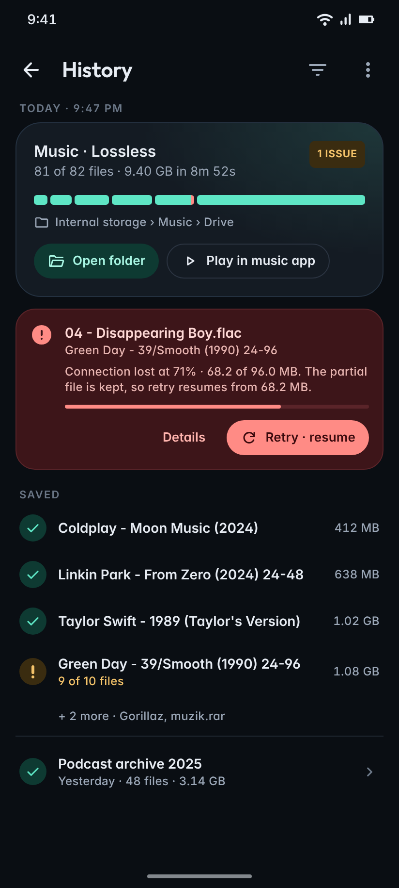
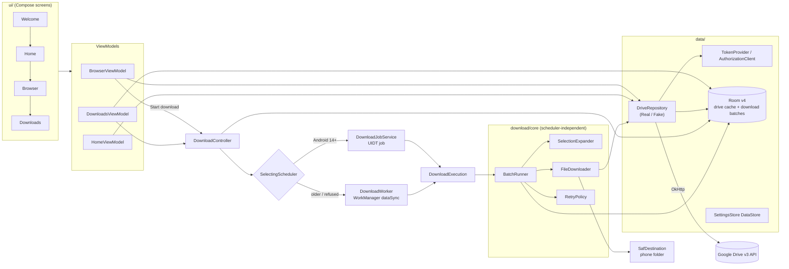

# Stashd

**Stash a whole Google Drive folder on your phone. It keeps going in the background and resumes where it stopped.**

     -3ddc84)

> **Status:** M0, M1 (M1a + M1b) and M2 are done in code with 134 passing unit tests. M3 (testing on a real phone) is next.
> The app has **not been run against real Google sign-in or the real Drive API yet**. That needs Google Cloud OAuth clients, which the owner hasn't created yet (see [SETUP.md](SETUP.md)). Until then everything runs in **demo mode** on sample data.

Stashd is a sideloaded hobby Android app (Kotlin, Jetpack Compose). It is not on the Play Store. You:

1. sign in with Google and allow read-only Drive access,
2. paste a Drive folder link (shared or your own, including old links with `resourcekey`),
3. browse the folder and tick files and folders (or "Download this folder"),
4. choose a folder on the phone, and
5. Stashd downloads everything with progress. It runs in the background, can be paused and resumed, and survives network drops.

---

## Screenshots

> **These are design mockups (HTML renders made during planning), not screenshots of the running app.** The real Compose UI follows them, but details differ. For example, the History screen still shows static sample data.

| Welcome | Home | Browser | Destination |
|---|---|---|---|
|  |  |  |  |

| Active downloads | Active (light) | Notification | History |
|---|---|---|---|
|  |  |  |  |

## Vision

- **v1: a dependable Drive-only downloader.** One job done well: get a large Drive folder (e.g. a lossless music library) onto the phone, intact (md5-verified), with the folder structure kept, and without babysitting it.
- **v2: any-link downloads, inspired by [Plexo](https://getplexo.app/).** Turn Stashd into a general download manager. Nothing below is built yet:
  - any HTTP/HTTPS link, not just Drive
  - parallel Range chunks per file
  - Wi-Fi and mobile data at the same time (opt-in, with a data cap)
  - a download queue with priorities
  - scheduled downloads (time window, charging, Wi-Fi)
  - speed limits per network
  - a share-sheet intent, so links shared from Chrome, WhatsApp or Drive open in Stashd
  - replacing an expired link: a new URL is accepted only if size and ETag/Last-Modified match, then the download resumes

## Features

### Done (in code, unit-tested; not yet verified on a phone or against real Drive)
- **Sign-in:** Credential Manager sign-in, then `drive.readonly` consent through AuthorizationClient. Cancel, deny and unticked-scope are handled. The token cache is keyed per account.
- **Links:** folder links in all common URL shapes, including `resourcekey` (sent as `X-Goog-Drive-Resource-Keys`). File links and inaccessible folders get clear messages. Stale link checks are cancelled.
- **Home:** paste a link, plus a list of recent folders.
- **Browser:** tap to enter folders, checkbox to select, breadcrumbs and back, selection kept across folders.
  - "Download this folder" works for the linked root or the open folder.
  - Loading, empty, error, consent and offline states.
  - Incomplete listings are shown as such (page cap / `incompleteSearch`), never cached as complete.
- **Drive cache:** Room, with nodes keyed by file id and a parent→child edge table. Shortcuts keep their own identity.
- **Downloading (M2):**
  - **Expanding the selection:** folders are expanded recursively with relative paths kept (or flattened). A file is downloaded once even if it is inside a selected folder, reachable through a shortcut, or has several parents.
  - **Writing files:** each file streams into a `.stashdpart` temp file and resumes with Range. If the file changed on Drive, it restarts. Size and md5 are checked before the rename.
  - **Names and storage:** unsafe names are cleaned up (`39/Smooth` → `39_Smooth`) and clashes get "(2)". Free space is checked first. A revoked folder grant pauses the batch.
  - **Batches:** one active batch at a time, stored in Room, with Pause, Resume, Cancel and "Retry failed files". Retries are bounded and back off. Failures are recorded with a reason.
  - **Background:** on Android 14+ downloads run as a user-initiated data transfer (UIDT) job, with a WorkManager foreground-service fallback. The notification has Pause/Cancel (Resume when paused).
  - **Downloads screen:** reads the batch from Room, with live speed and ETA.
- **Privacy:** HTTP logging hides `Authorization`, cookies, resource keys and token parameters.
- **Demo mode:** with no credentials, a fake Drive serves sample folders and real generated bytes, so the whole download flow can be tried without Google Cloud.

### Planned
- Real History screen, real DB migrations, faster resume of large files, testing on a real phone (M3). See the [Roadmap](#roadmap).
- Google Docs/Sheets/Slides export (for now they are skipped and listed).
- Downloading several files at once (the setting exists; M2 downloads one file at a time).
- v2 any-link features (above).

## Tech stack

| | |
|---|---|
| Language / UI | Kotlin 2.2.21, Jetpack Compose (BOM 2025.10.01), Material 3, type-safe Navigation 2.9.5 |
| DI | Hilt 2.57.2 (+ hilt-work) |
| Storage | Room 2.8.3 (KSP, schema v4), DataStore Preferences, Storage Access Framework (DocumentFile 1.1.0) |
| Network | OkHttp 4.12.0 against the Drive v3 REST API, kotlinx.serialization 1.9.0 |
| Auth | Credential Manager 1.5.0 + Google ID 1.1.1 (sign-in), Play Services AuthorizationClient 21.4.0 (Drive scope) |
| Background | JobScheduler user-initiated data transfer jobs (API 34+), WorkManager 2.11.0 fallback |
| Build | AGP 8.13.2, Gradle 8.14.3, JDK 17, compileSdk 36, targetSdk 35, minSdk 26 |
| Tests | JUnit 4, Robolectric 4.16, OkHttp MockWebServer, kotlinx-coroutines-test |

## Architecture overview

Single Gradle module (`:app`), package `com.abhranil.stashd`, organised by layer. The downloader core knows nothing about schedulers or Android UI, so both schedulers call the same code and it can be unit-tested against fakes. Details are in [docs/ARCHITECTURE.md](docs/ARCHITECTURE.md).



## Getting started

**Requirements:** JDK 17, Android SDK with platforms 35 and 36 (compileSdk 36), an Android 8.0+ phone or emulator. Android Studio Narwhal or newer is optional.

```bash
git clone <this repo> stashd && cd stashd     # or: git clone stashd-*.bundle stashd
./gradlew assembleDebug                        # → app/build/outputs/apk/debug/app-debug.apk
adb install -r app/build/outputs/apk/debug/app-debug.apk
```

**Demo mode (no credentials needed):** if `stashd.webClientId` is not set, Welcome skips sign-in and the app uses `FakeDriveRepository`. It has sample albums, nested folders, a resource-keyed folder, an empty folder, a no-access folder, a Google Doc and a shortcut. Picking a destination folder and tapping **Start download** writes real generated bytes (about 4 MB/s) through the same downloader, scheduler and notification used for real Drive. To force demo data even when a client ID is set, add `stashd.fakeDrive=true` to `~/.gradle/gradle.properties`.

Full build and check, as used for every milestone:

```bash
./gradlew clean assembleDebug testDebugUnitTest lint
```

## Google Cloud setup (summary)

Real Google sign-in needs a Google Cloud project that **you** create. Nothing has been created for you. In short:

1. create a project and enable the **Google Drive API**,
2. set the OAuth consent screen to External / **Testing**, add the `drive.readonly` scope, and add yourself as a test user,
3. create an **Android** OAuth client (package `com.abhranil.stashd` + your debug SHA-1 from `./gradlew signingReport`),
4. create a **Web** OAuth client and put its ID in `~/.gradle/gradle.properties` as `stashd.webClientId=…` (never in the repo).

Every place in the code that depends on this is marked `TODO(cloud-setup)`:

```bash
git grep -n "TODO(cloud-setup)" -- ':!SETUP.md'
```

Step-by-step instructions, the TODO table and the first live-test checklist are in **[SETUP.md](SETUP.md)**.

## Roadmap

Full milestone list in [docs/ROADMAP.md](docs/ROADMAP.md).

**M3: device acceptance and hardening (next)**
- [ ] Real History screen backed by Room (currently static sample data)
- [ ] Real Room migrations instead of the destructive fallback (v4 wipes cache and history on upgrade)
- [ ] Faster resume for large files (resume currently re-hashes the whole partial file for md5)
- [ ] Device acceptance checklist ([SETUP.md §5b](SETUP.md)): UIDT on Android 14+, screen-off, airplane mode, swipe-away, SD card eject, WorkManager on Android 8–13
- [ ] Sign-out / switch-account UI
- [ ] Pull-to-refresh in the browser
- [ ] Automatic backoff/retry for browser listings (429/5xx)
- [ ] Restore browser state (path, selection) after process death
- [ ] Google Docs/Sheets/Slides export (currently skipped and listed)
- [ ] Several files downloading at once (the parallelism setting exists but isn't used)

**Cloud setup (owner)** — see [SETUP.md](SETUP.md)
- [ ] Create the Google Cloud project and enable the Drive API
- [ ] Consent screen in Testing with `drive.readonly`, add yourself as a test user
- [ ] Android OAuth client with your debug SHA-1 (one per build machine)
- [ ] Web OAuth client → `stashd.webClientId` in `~/.gradle/gradle.properties`
- [ ] First live run: the SETUP.md §5 checklist (sign-in, consent, real listings, resource keys, a real download)

**v2: any-link downloads (Plexo-inspired)**
- [ ] Paste any HTTP/HTTPS link (HEAD / `Range: bytes=0-0` for size, name, ETag)
- [ ] Parallel Range chunks per file, with a chunk bitmap persisted for resume
- [ ] Wi-Fi + mobile data together (opt-in, per-batch data cap)
- [ ] Download queue with priorities
- [ ] Scheduled downloads (time window, Wi-Fi, charging)
- [ ] Per-network speed limits
- [ ] Share-sheet intent (`ACTION_SEND` text, `ACTION_VIEW` http/https)
- [ ] Replace an expired link without losing progress

## Known limitations

- **`drive.readonly` is a restricted Google scope.** That's fine for a personal app in **Testing** mode with you as a test user. Publishing it to others would need Google's restricted-scope verification, or a switch to `drive.file` + Picker. In Testing mode Google **expires the consent after 7 days**, so the app will ask for Drive access again. Downloads that hit this pause with "sign in again" rather than failing.
- **Android background limits.** On Android 14+ the download runs as a UIDT job. Android 8–13 (or when the system refuses the job) uses a WorkManager `dataSync` foreground service, which is subject to Android 15's dataSync time limits and to OEM battery savers. Starting or resuming from the background can be refused by the system. Not yet tested on real devices.
- **Google Docs, Sheets and Slides are skipped** (recorded as "skipped" with the reason); export is planned. Files whose owner disabled downloading are skipped too.
- **Not tested against real Google yet**: the real sign-in, consent and Drive REST paths are only exercised with MockWebServer and fakes.
- One active batch at a time and one file at a time. The DB upgrade path is destructive (cache and download history are wiped; downloaded files stay).

## Testing

134 JVM unit tests (JUnit 4 + Robolectric + MockWebServer), covering:
- link parsing, auth/consent decisions and per-account tokens
- the Drive cache, shortcuts and log redaction
- the REST client and media download (Range/206/416)
- the file downloader: resume, remote change, md5, storage failures
- selection expansion: dedup, paths, Docs
- the batch runner and controller: retries, pause/resume/cancel, one active batch
- retry rules, scheduler choice, and the browser view models

```bash
./gradlew testDebugUnitTest                       # all unit tests
./gradlew testDebugUnitTest --tests '*BatchRunnerTest'
./gradlew lint                                    # Android lint (currently clean)
```

There are no instrumented or UI tests yet. On-device checks are the M3 checklist in [SETUP.md](SETUP.md).

## Docs

- [SETUP.md](SETUP.md): build, Google Cloud setup, `TODO(cloud-setup)` list, live and phone test checklists
- [docs/ARCHITECTURE.md](docs/ARCHITECTURE.md): packages, data model, download pipeline, policies
- [docs/ROADMAP.md](docs/ROADMAP.md): milestones M0–M5 and v2
- [docs/DECISIONS.md](docs/DECISIONS.md): short decision records
- [CHANGELOG.md](CHANGELOG.md)

## License

TBD — choose before publishing.
