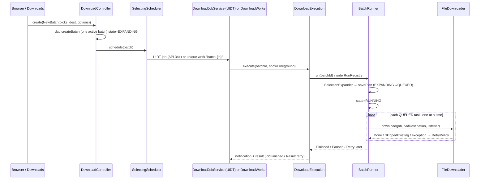

# Stashd architecture

State at `main` after M2 (commit `90dc6e3`). Single Gradle module `:app`, package `com.abhranil.stashd`. Setup and credentials: [../SETUP.md](../SETUP.md). Why things are this way: [DECISIONS.md](DECISIONS.md).

## Packages

| Package | What lives there |
|---|---|
| `StashdApp`, `MainActivity` | Hilt application (WorkManager configured with `HiltWorkerFactory`, its JobScheduler id range set to 1000–5000), notification channel, single activity |
| `ui/nav` | `StashdNavHost`, type-safe routes: Welcome → Home → Browser(folderId, resourceKey, name) → Downloads; NotificationPreview, History |
| `ui/screens` | Compose screens + view models: `WelcomeScreen`, `HomeScreen`/`HomeViewModel` (paste link, recent folders), `BrowserScreen`/`BrowserViewModel` (navigation, selection, destination sheet, "Start download"), `DownloadsScreen`/`DownloadsViewModel`, `HistoryScreen`/`HistoryViewModel` (Room-backed, retries), `AccountMenu`/`AccountViewModel` (sign out, switch), `NotificationPreviewScreen` (design preview) |
| `ui/components`, `ui/theme` | Shared composables (progress bar, overline, consent launcher), theme and fonts |
| `data/auth` | `SignInClient` (Credential Manager), `AuthorizationBackend`/`PlayAuthorizationBackend` (AuthorizationClient, `drive.readonly`), `GoogleTokenProvider` (token cache keyed by account; `NeedsConsentException`) |
| `data/drive` | `DriveRepository` interface; `RealDriveRepository` (OkHttp, Drive v3), `FakeDriveRepository` (demo), `DriveMode` (which one), `LinkParser`, `DriveModels` (`DriveItem`, `DriveError`, `DriveDownload`), `DriveCache`/`FolderCache` |
| `data/db` | Room `StashdDatabase` v4, entities, DAOs |
| `data/net` | `HttpLogging`: debug HTTP logs with `Authorization`, cookies, resource keys and token params redacted |
| `data/settings` | `SettingsStore` (DataStore): account, last destination tree URI, Wi-Fi only, keep structure, skip existing, parallelism (not used yet) |
| `data/storage` | `NameSanitizer` (illegal characters → `_`, 200-byte UTF-8 cap keeping the extension, case-insensitive dedupe "name (2).ext") |
| `download/core` | Scheduler-independent engine: `SelectionExpander`, `FileDownloader`, `BatchRunner`, `RetryPolicy`, `DownloadController`, `RunRegistry`, `DownloadScheduler` interface |
| `download/storage` | `Destination`/`DestDir` interfaces, `SafDestination` (SAF tree via DocumentFile), `StorageError` |
| `download/worker` | Android adapters: `SelectingScheduler`, `UidtScheduler`, `WorkManagerScheduler`, `DownloadJobService` (UIDT), `DownloadWorker` (WorkManager), `DownloadExecution`, `DownloadNotifier`, `DownloadActionReceiver` |
| `download/progress` | `ProgressBus` (in-process live snapshot) + `SpeedMeter` (EMA speed) |
| `di` | `AppModule` (DB, OkHttp, Drive repository choice, auth bindings), `DownloadModule` (runner, controller, scheduler, SAF destination factory, app scope) |

## Demo vs real Drive

`DriveMode.useFake` is true when `BuildConfig.WEB_CLIENT_ID` is blank (no `stashd.webClientId` Gradle property) or `stashd.fakeDrive=true`. `AppModule` then provides `FakeDriveRepository`, the token provider short-circuits, and Welcome skips sign-in. All credential touchpoints are tagged `TODO(cloud-setup)` (list in [SETUP.md](../SETUP.md#cloud-setup-todos)).

## Data model (Room v5)

Schemas are exported in `app/schemas/` (1–5) and checked in. From v4 on, every upgrade is a hand-written `Migration` in `data/db/Migrations.kt` with a `MigrationTest` (Room `MigrationTestHelper`; the schemas are debug-only assets so Robolectric can read them). Only v1–v3 (pre-M2 dev builds) fall back to a destructive wipe. v5 adds `file_task.md5State`: a `ResumableMd5` midstate saved every 8 MB so a resume re-hashes only the tail.

**Drive cache**
| Table | Key | Purpose |
|---|---|---|
| `drive_root` | `folderId` | Pasted links for Home's recent folders (resource key, name, totals, last opened) |
| `drive_node` | `fileId` | One row per Drive item, not owned by any root. Shortcuts keep their own id; the target goes in `targetId`/`targetMimeType`/`targetResourceKey` |
| `drive_edge` | (`parentId`, `childId`) | Parent→child links with position; supports multi-parent items |
| `drive_listing` | `folderId` | When a folder was last listed **completely**. Incomplete listings are never recorded here |

**Downloads**
| Table | Key | Purpose |
|---|---|---|
| `download_batch` | `id` | One per "Start download": root, destination tree URI, options (keep structure, Wi-Fi only, skip existing), `state`, `pauseReason`, `message`, totals, duplicates removed, timestamps |
| `download_item` | `id`, FK batch | The user's picks: serialized `DriveItem` fields (incl. shortcut target) + `parentNames` + order |
| `file_task` | `id`, FK batch, unique (`batchId`, `fileId`) | One per file: `dirSegments`, `plannedName`, `finalName`, `tempName`, expected `size`/`md5`/`modifiedTime`, `bytesDone` (resume offset), `state`, `attempts`, `errorReason`, `errorMessage`, `finalUri` |

Batch states: `EXPANDING`, `QUEUED`, `RUNNING`, `PAUSED` (all count as **active**), then `COMPLETED`, `COMPLETED_WITH_ERRORS`, `CANCELLED`, `FAILED`.
Pause reasons: `USER`, `STORAGE_FULL`, `DESTINATION_REVOKED`, `NEEDS_CONSENT`, `AUTH`, `SYSTEM`.
Task states: `QUEUED`, `RUNNING`, `DONE`, `SKIPPED`, `FAILED`, `CANCELLED`.
Failure reasons: `NOT_FOUND`, `CANNOT_DOWNLOAD`, `GOOGLE_DOC`, `AUTH`, `CHECKSUM`, `RETRIES_EXHAUSTED`, `FORBIDDEN`, `EXISTS`, `OTHER`.

`DownloadDao.createBatch` checks for an active batch and inserts in **one transaction**, throwing `ActiveBatchExists` if there is one. `savePlan` inserts the expanded tasks and moves the batch to `QUEUED` atomically. Duplicate `(batchId, fileId)` rows are ignored.

## Download pipeline

1. **Picks.** `BrowserViewModel.picks()` turns selections into `PickedItem(item, parentNames)`. `parentNames` runs from the linked root (excluded) to where the item was picked. "Download this folder" is just a folder pick.
2. **Expansion** (`SelectionExpander`):
   - It walks folders breadth-first through `listChildren`. Folders reached through a shortcut are walked after real ones, and each target folder is visited once, so shortcut cycles are safe.
   - A selected folder's own name prefixes its subtree. With "keep folder structure" off, everything is flattened.
   - A shortcut to a file costs one `fileMetadata` call to get its size and md5.
   - **Dedup by target file id:** a non-shortcut copy beats one reached through a shortcut, then the shallowest wins, then the first seen.
   - Names are sanitized and made unique per directory.
   - Google Docs and `canDownload=false` files become `SKIPPED` tasks with a reason.
   - Drive's `incompleteSearch` aborts the expansion so it can be retried, rather than giving a silently partial plan.
3. **One file** (`FileDownloader`, stateless):
   - **Access and names:** it checks destination access. On the first start it claims a collision-free final name and a temp `<final>.stashdpart`, and saves both before writing bytes.
   - **Resume check:** if a temp file exists, it re-fetches metadata. If size, md5 or modifiedTime differ, it deletes the temp and starts from 0.
   - **Space check:** free space must cover the remaining bytes plus a 200 MB margin.
   - **Request:** it hashes the existing prefix, then opens `files.get?alt=media` with `Range: bytes=<offset>-` and `Accept-Encoding: identity`.
   - **Reply handling:** a 206 is validated against `Content-Range`. A 200 to a Range request restarts from 0. A 416 or wrong range restarts once, unless the temp is already complete.
   - **Streaming:** 256 KB buffers. Each chunk checks for cancellation and reports progress.
   - **Verify and rename:** it checks the size, then the md5 (when Drive gave one). On mismatch it deletes the temp and throws `ChecksumMismatch`. Then it renames to the final name, re-deduping if the name was taken meanwhile.
4. **Batch** (`BatchRunner`):
   - It re-queues tasks left `RUNNING` by a killed process and runs tasks **sequentially**.
   - It persists `bytesDone` about once a second and when stopping.
   - It reports `BatchProgress` to `DownloadExecution`, which updates `ProgressBus` and the notification (at most once a second).
5. **Progress to UI.** `DownloadsViewModel` combines the latest batch, `totals()` and the failed-task list from Room with the live `ProgressBus` snapshot (speed and ETA).

## Retry and error policy (`RetryPolicy`)

| Failure | Decision |
|---|---|
| 429 (`RateLimited`), 5xx (`Server`), range mismatch / 416 | Retry the same file: up to **5 attempts**, then `FAILED` / `RETRIES_EXHAUSTED`; the batch continues |
| Network `IOException` | Retry; after **5 in a row** in one run → `RetryLater` (batch `QUEUED`, "Waiting for network", file stays queued) and the scheduler re-runs it when the network is back; a file fails after **15** network attempts in total |
| `ChecksumMismatch` (size or md5) | One full restart (2 attempts), then `FAILED` / `CHECKSUM` |
| `NotFound`, `CannotDownload` (cannotDownloadFile, cannotDownloadAbusiveFile, downloadQuotaExceeded…), `NotDownloadable` (Docs), `Forbidden`, other Drive errors | Terminal for that file, reason + message saved |
| `StorageError.InsufficientSpace` (pre-check or ENOSPC) | **Pause batch**: `STORAGE_FULL` |
| `StorageError.AccessRevoked` (SAF grant gone, card removed) | **Pause batch**: `DESTINATION_REVOKED` |
| `Unauthorized` (after one token refresh) / `NeedsConsentException` | **Pause batch**: `AUTH` / `NEEDS_CONSENT`, rather than failing every file |

Backoff: exponential from 2 s, capped at 60 s, with "equal jitter" (half fixed, half random), so attempts wait 1–2 s, 2–4 s, 4–8 s and so on. A server `Retry-After` is honoured, capped at 5 minutes. Expansion uses the same policy: network errors end in `RetryLater`, other errors in `FAILED`, and an auth or storage problem pauses.

## Pause, resume, cancel (`DownloadController`)

- **Pause** (app button, notification action, or the user stopping the job from Android 14's Task Manager): the batch becomes `PAUSED/USER` first. Then the in-process run is cancelled and waited for (`RunRegistry.stop`), and the job is unscheduled. Temp files and `bytesDone` are kept.
- **Resume:** `PAUSED` → `QUEUED`, then schedule. Each file resumes with Range after the remote fingerprint check. A batch paused before its plan was saved is expanded again.
- **Cancel: delete partials.** The batch becomes `CANCELLED`, the run is stopped and unscheduled, and the `.stashdpart` file of every unfinished task is deleted. Those tasks become `CANCELLED` and their temp names and offsets are cleared. **Finished files stay** in the destination, and empty directories may remain.
- **Retry failed files:** only for `COMPLETED_WITH_ERRORS`, and only if no other batch is active. `FAILED` tasks are re-queued with their attempts reset. They keep their temp files, so they resume.
- **System stop** (network lost, quota, process death): the runner moves `RUNNING` → `QUEUED`, and the next run continues from saved offsets. At most about one second of bytes is downloaded again.

## Scheduler choice

`SchedulerSelector.preferred(sdk)` picks UIDT for API ≥ 34 and WorkManager below that.

- **UIDT** (`UidtScheduler`, `DownloadJobService`):
  - The job is set up with `JobInfo.Builder.setUserInitiated(true)` and a network constraint (`NOT_METERED` when Wi-Fi only). It gets an estimated byte count, and its job id is `7000 + batchId % 1000`.
  - It needs `RUN_USER_INITIATED_JOBS` and calls `setNotification` before any network I/O.
  - `onStopJob` with `STOP_REASON_USER` counts as a pause. Other stops cancel the run and ask to be rescheduled, and `RetryLater` → `jobFinished(needsReschedule = true)`.
  - If `schedule()` is refused or throws, `SelectingScheduler` falls back to WorkManager.
- **WorkManager** (`WorkManagerScheduler`, `DownloadWorker`): unique work `batch-{id}` with `REPLACE`, a network constraint (`UNMETERED`/`CONNECTED`), exponential backoff from 30 s, and `setForeground` with type `dataSync`. `RetryLater` → `Result.retry()`.
- Both call **`DownloadExecution.execute`** → `BatchRunner.run`. `RunRegistry` holds a mutex, so only one runner is active per process.

Notifications (channel `downloads`): progress (id 4101) with Pause/Cancel; a separate result notification (id 4102) for paused (with reason, Resume/Cancel) or finished. Actions go to `DownloadActionReceiver` → `DownloadController`.

## Logging and privacy

- HTTP logs go through `HttpLogging`, which redacts `Authorization`, cookies, resource keys and bearer/token query parameters (covered by tests).
- Download logs (`Stashd/Batch`, `Stashd/Sched`, `Stashd/UIDT`, `Stashd/Ctl`) contain ids, counts and exception class names, not file names or tokens.
